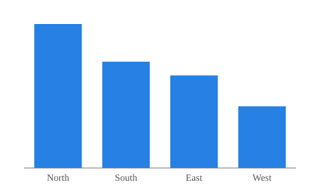
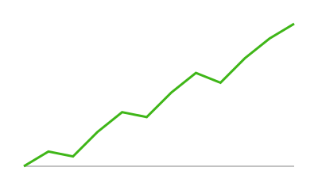

## Row {height=60%}

::: {.card title="Sales by region"}
{fig-alt="Bar chart of sales by region: North highest, West lowest."}
:::

::: {.card title="Monthly visits"}
{fig-alt="Line chart of monthly visits rising through the year."}
:::

## Row {height=40%}

### Column {width=60%}

::: {.card title="Top products"}
| Product   | Units | Revenue |
|-----------|------:|--------:|
| Notebook  | 1,240 | \$9,920  |
| Pen set   |   980 | \$4,900  |
| Backpack  |   410 | \$16,400 |
| Desk lamp |   305 | \$9,150  |
:::

### Column {width=40%}

::: {.card title="Notes"}
Each `##` heading starts a **row** and each `###` heading inside it starts a
**column**. `height` and `width` attributes on the headings share out the
space; cards fill the window.
:::
