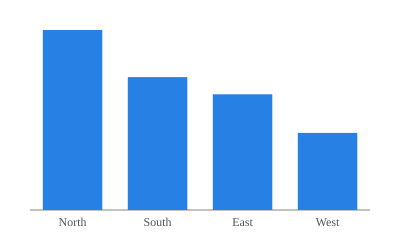
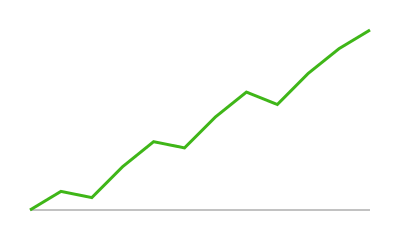
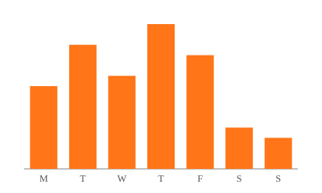

# Sales

## Row

::: {.card title="Sales by region"}
{fig-alt="Bar chart of sales by region."}
:::

::: {.card title="Monthly visits"}
{fig-alt="Line chart of monthly visits."}
:::

# Support {orientation="columns"}

## Column {width=60%}

::: {.card title="Tickets by day"}
{fig-alt="Bar chart of support tickets per weekday."}
:::

## Column {width=40%}

::: {.card title="Open tickets"}
| Priority | Open |
|----------|-----:|
| High     |    4 |
| Medium   |   17 |
| Low      |   32 |
:::

::: {.card title="About this page"}
This page sets `orientation="columns"` on its heading, so its `##` sections
are columns instead of rows.
:::
