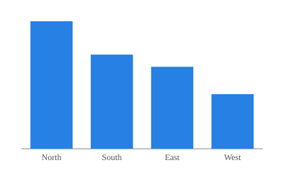
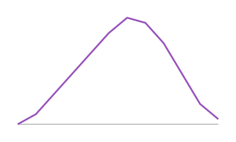

# Sidebar

## {.sidebar width="260px"}

### About

This sidebar holds notes and, in an interactive dashboard, inputs. Use the
arrow at its edge to collapse it.

### Data

Regional sales, fiscal year 2026.

## Column

::: {.card title="Sales by region"}
{fig-alt="Bar chart of sales by region."}
:::

# Toolbar

## {.toolbar}

**Station:** Lisbon · **Period:** 2026

## Row

::: {.card title="Monthly temperature (°C)"}
{fig-alt="Line chart of monthly temperature, peaking in July."}
:::
