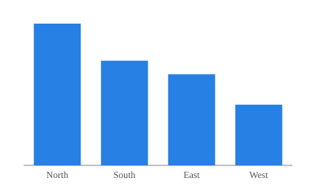
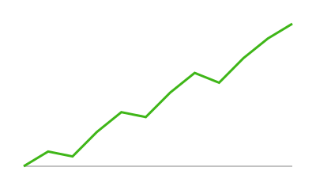
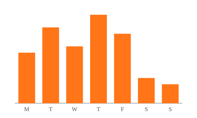

## Row

### Charts {.tabset width=40%}

::: {.card title="Sales"}
{fig-alt="Bar chart of sales by region."}
:::

::: {.card title="Visits"}
{fig-alt="Line chart of monthly visits."}
:::

### Tickets {width=40%}

::: {.card-toolbar}
Updated 3 Nov 2026
:::

::: {.card title="Tickets by day"}
{fig-alt="Bar chart of support tickets per weekday."}
:::

### Notes {width=20%}

::: {.card title="About"}
The `Charts` column heading has the `.tabset` class, so its two cards share
one card, with a tab for each title.

The toolbar above "Tickets by day" is a `.card-toolbar` div, placed in the
header of the card after it.
:::
