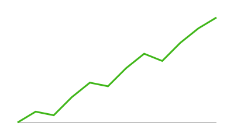

# Overview

## Row

::: {.card title="Monthly visits"}
{fig-alt="Line chart of monthly visits."}
:::

::: {.card title="In the bar above"}
- The logo and the title, subtitle and author
- The **Overview** and **About** page tabs
- LinkedIn and GitHub buttons
- The dark-mode toggle
:::

# About

## Row

::: {.card title="About this example"}
The navigation bar shows the title, subtitle and author, a logo, the page
tabs, share and link buttons, and a dark-mode toggle (because the theme has a
light and a dark variant).
:::
