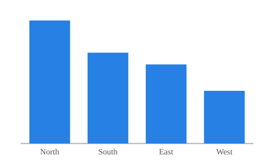

# Regions

## Row

::: {.card title="Sales by region"}
{fig-alt="Bar chart of sales by region."}
:::

::: {.card title="Notes"}
This dashboard is a page of a website: the site's navigation bar and footer
frame it, and it uses the site's `cosmo` theme.
:::

# Details

## Row

::: {.card title="Regional totals"}
| Region | Sales |
|--------|------:|
| North  |    42 |
| South  |    31 |
| East   |    27 |
| West   |    18 |
:::
